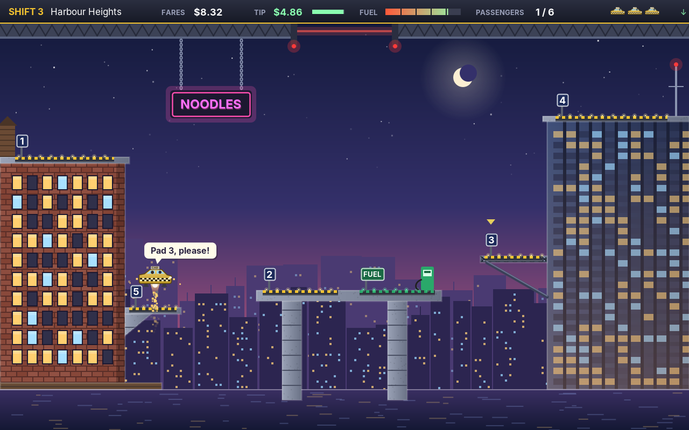

# amade-hover-cab-game

**amade-hover-cab-game** is the flying cab of the [amadeOS](https://github.com/amadeos-eu/amadeos) desktop: steer a cab with a main jet, side jets and a roof jet against gravity and wind, land gently on numbered pads, pick up the passengers who hail you and fly them to the pad they ask for. Twelve shifts, from the rooftops of a city to a mine, a canyon, a factory with a lift, an orbit station and a storm at sea. The passengers call out in voices made by the engine's speech synthesizer. Built on [amade-game-engine](https://github.com/amadeos-eu/amade-game-engine); runs on other operating systems as well.




## Playing

- **Enter**, **Space** or **Start** on a gamepad starts the first shift from the title, where the autopilot flies.
- **Up** (or **W**) fires the main jet under the cab, **left** and **right** (or **A** and **D**) the side jets, **down** (or **S**) the roof jet, which pushes the cab down. Jets burn fuel.
- **Space** (or **G**) moves the landing gear out or in. The cab starts with it out.
- Land only with the gear out, slowly, and with both legs on the deck of a pad. Anything else is a crash: a wall, a roof, a moving van, the sea, a closed gate, coming down too fast, or landing with the gear in. A firm landing is allowed but costs the passenger's tip a dollar.
- A passenger appears on a pad and calls "Hey, cab!". Land on their pad: they walk to the cab, get in and say where to, "Pad 3, please!". Land there and they pay the **fare** (two dollars and one for every hundred units of distance) and the **tip**, which starts at five dollars and melts during the ride.
- The **fuel pad** (green) fills the tank while the cab stands on it, for money from the till.
- The last passenger of a shift says "Up, please!": the gate in the ceiling opens, and flying out through it ends the shift.
- Three spare cabs at the start, and another for every hundred dollars earned. The best earnings enter the high score table.
- **P** or **Esc** pauses, and so does leaving the window; **Esc** in the pause leaves the game.
- Gamepads: d-pad or left stick to steer, **A** or **Up** for the main jet, **B** or **Down** for the roof jet, **X** or **Y** for the gear, **Start** to pause.
- **F11** switches to full screen and back. *Game → Graphics* chooses how the shift reaches the screen: **Direct** (at the screen's full size) or **Pixels** (640 × 400, enlarged by whole factors). **F12** shows how long each frame takes.
- Sound effects, voices and music can be switched off under *Game → Sound*.

The keys can be changed in `~/.config/amadeos/hovercab/hovercab.properties`, with the names Java gives them, several separated by spaces:

```properties
keys.left=LEFT A
keys.right=RIGHT D
keys.up=UP W
keys.down=DOWN S
keys.gear=SPACE G
keys.pause=P ESCAPE
```

Texts and voices in English, Deutsch, Français, Español and Italiano.

## Gamepads

Plugged in before or while the game runs; any of them plays. *Help → About* shows how many are connected.

- **Linux**: the game reads `/dev/input/js0` to `js3`, which needs read access to them (on most desktops the user at the screen has it). The buttons follow the Xbox layout of the `xpad` driver.
- **Windows**: XInput, so Xbox and compatible controllers.
- Elsewhere the game runs without gamepads.

## Files

| What | Where |
|---|---|
| Settings (graphics, sound, keys) | `~/.config/amadeos/hovercab/hovercab.properties` |
| Best earnings | `~/.local/share/amadeos/games/hovercab/` |

## Making shifts

The shifts are text files, `src/main/resources/eu/amadeos/games/hovercab/shifts/shift1.txt` to `shift12.txt`, one thing per line, `#` starts a comment. The screen is 640 × 400 units; the top bar takes 22, the ceiling with the gate reaches down to 36.

```text
name Harbour Heights         # the shift's English name; the translations are in messages_*.properties
theme dusk                   # day, dusk, night, cave, canyon, snow, space, factory, storm
gravity 1                    # optional: a factor of the normal gravity
air 0.2                      # optional: how much the air slows the cab per second
wind 0 30 5                  # optional: a steady push, gusts up to so much on top, a gust every so many seconds
sea 372                      # optional: water from this height down
gate 300 380                 # where the gate in the ceiling is, from x to x
start 2                      # the pad the cab starts on
block brick 0 150 120 250    # a solid: look x y width height
poly rock 0 300 60 280 90 320 0 320   # a solid polygon: look and its corners
beam 100 36 100 150          # a solid steel strut from a point to a point
sign pink 160 60 70 22 NOODLES   # a solid neon sign on chains from the ceiling: colour x y width height text
deco lamp 120 360            # a decoration that does not collide
pad 1 10 150 90              # a pad: number x y width; y is the top of its deck
fuel 334 270 70              # the fuel pad
lift 6 300 200 60 320 8      # a pad that moves: number x y width, down to y2, there and back in so many seconds
mover van 150 62 40 14 140 0 6 0   # a moving block (also van or drone): look x y w h, by dx dy, in seconds, starting late by
riders 2>4 1>3 5>2 4>up      # the passengers in order, from pad to pad; the last one wants up
```

The looks are `brick`, `glass`, `concrete`, `steel`, `rock`, `ice`, `hull`, `wood`, `sand` and `plain`; the decorations `tank`, `antenna`, `tree`, `pine`, `lamp`, `crane`, `chimney`, `dish`, `pipe`, `cactus`, `crystal` and `flag`. A mistake is reported with the file and the line.

`AutopilotTest` flies every shift with the autopilot, through all passengers and out through the gate without a crash, so a shift that cannot be flown fails the build.

## Building

```bash
./gradlew test          # the window test needs a display (xvfb-run on servers)
./gradlew run
./gradlew deb           # build/distributions/amade-hover-cab-game_<version>_all.deb
./gradlew installToAmadeOs   # copies the package to ../amadeos/config/packages.chroot/
./gradlew benchmark     # the frame times of every shift
```

Gamepads on Windows go through Java's foreign function interface, so the game starts with `--enable-native-access=ALL-UNNAMED` (set in `build.gradle` for `run`, the tests and the packages).

All pictures are drawn with Java2D shapes at run time; the icon is drawn by `tools/MakeIcon.java`. `./gradlew screenshots -Pshots=<folder>` draws the handbook's screenshots.

With `../amade-game-engine` (and `../amade-commons`) checked out next to this repository, Gradle builds those checkouts instead of the JitPack versions.

## Structure

- `domain`: the rules without user interface or time of their own. `Game` (a shift being flown: jets, gear, landing and crashing, the passengers, fares and tips, fuel, the gate), `Shift` (reads a shift's file and makes its collision mask), `Cab`, `CabShape` (the cab's outline and pixel masks), `Rider`, `Pad`, `Mover`, `Career` (money and spare cabs from shift to shift), `Autopilot` (flies the title screen and the tests), `Input`, `Call`, `Event`, `Field` (sizes, jets, gravity, money), `ShiftResult`, `GameResult`.
- `repository`: `HoverCabSettings` (graphics, sound, keys).
- `ui.game`: the running game on the loop thread. `HoverCabGame` (loop, controls, scenes: title, play, pause, end of a shift, end of the game), `Painter` (the shift and what moves in it), `Scenery` (the still picture of a shift, drawn once), `Backdrop` (skies and far views of the themes), `CabArt`, `People` (six kinds of passengers, each with a voice), `Voices` (what they say, in words and as speech), `Hud` (top bar, speech bubbles, banners, cards), `Effects` (events become particles, sounds and music), `SoundBank`, `Music` (the tunes, in MML), `Arena` (what the presenter may ask of the game).
- `ui.main`: Model-View-Presenter for everything around the shift: `HoverCabPresenter`, `HoverCabView`, `HoverCabWindow`.

From the engine: `Speech` and `Phoneme` (formant speech synthesis), `PixelMask`, `Body`, `Thrusters` and `Touchdown`, `DistanceMap`, `TextData`, `HighScores`, `Gamepads`, `GameLoop`, `GameCanvas`, `Sprite`, `Particles`, `Sound`, `Tune` and `Mixer`, `Keyboard` and `Controls`, `SceneStack`, `FullScreen`.

Comments of the form `// --8<-- [start:name]` mark the excerpts the [Game Developer's Handbook](https://datazuul.github.io/amade-game-engine/) quotes; chapter 28 is about this game.

## Licence

[EUPL-1.2](LICENSE)
